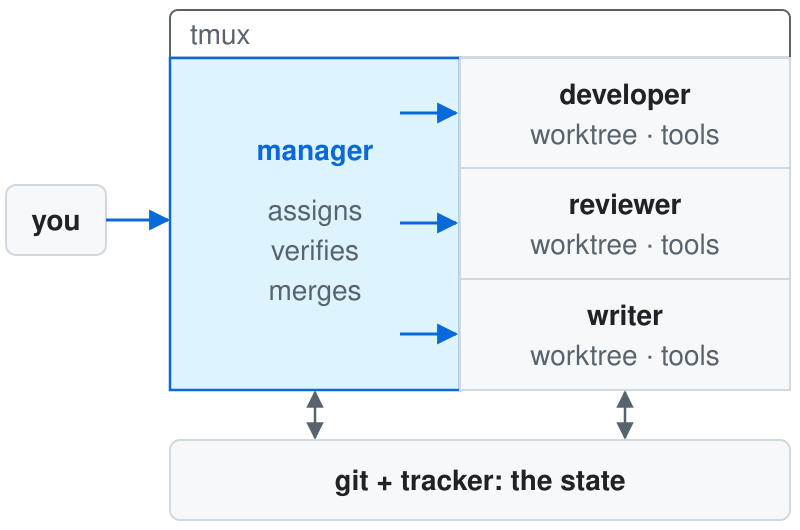
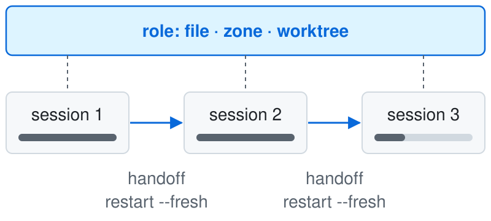
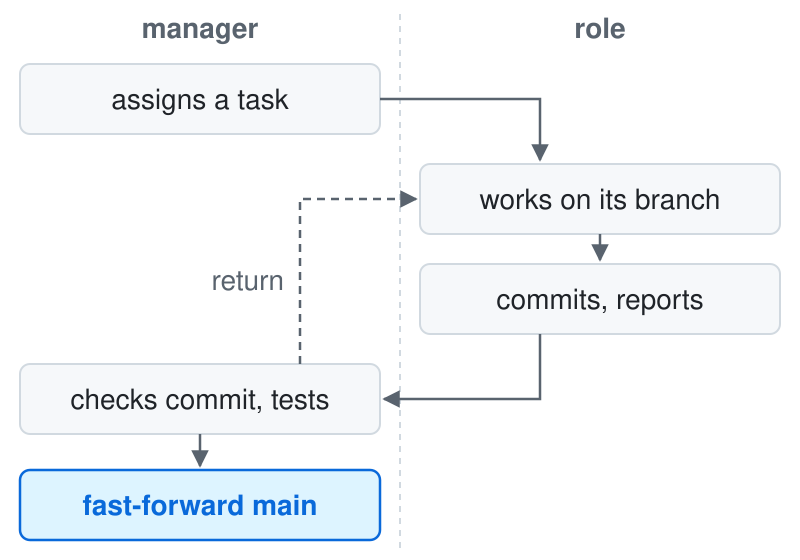

# agent-team

A team of Claude Code agents in tmux: you talk to one manager; roles are permanent, sessions are disposable — state lives in git and your tracker, not in the agent's context.

`team` is a command-line tool that starts Claude Code sessions from role files kept in your project's `agents/` directory. The tool knows nothing about your project: roles, zones, rules and the test command all live in those files.

## How it works

You give tasks to the manager; the manager hands them to roles working next to it, and the work itself lands in git and your tracker.

<picture><source media="(prefers-color-scheme: dark)" srcset="docs/images/architecture-dark.svg"></picture>

The whole team lives in one tmux session, `team-<project>`. In the `panes` layout that `team init` sets up, the manager takes the left half of the window and every other role gets a pane on the right, so you can attach and watch all of them at once. A role that edits files works in its own git worktree on its own branch. Every role starts with a fixed list of allowed tools: file reading and editing, `git`, the project's test command, and whatever its role file adds. The manager sends tasks to roles with Claude Code's built-in `SendMessage`, addressed to each role's session socket.

## Roles are permanent, sessions are disposable

A role keeps its file, name, zone and worktree; the Claude session behind it can be replaced at any time without losing work.

<picture><source media="(prefers-color-scheme: dark)" srcset="docs/images/role-session-dark.svg"></picture>

The bar inside each session is its context filling up. When a session's context is full, or the session crashes, the manager asks the role for a handoff: a short note on what is done, what is in progress and what comes next. The role prints it in its pane and posts it to the task in the tracker. Then `team restart <role> --fresh` starts a new session that picks up from the handoff, the branch and the tracker. Without `--fresh`, `restart` resumes the same session.

## The path of a task

The manager accepts work by checking facts — the commit and the test output — not by reading the report.

<picture><source media="(prefers-color-scheme: dark)" srcset="docs/images/task-flow-dark.svg"></picture>

A role never merges its own work. The manager checks the branch, runs the tests and either returns the task or fast-forwards `main` to the role's branch. The tool itself never merges anything: when to merge, and whose consent it needs, is written in the manager's role file. The manager from the role library merges only what you named, and a reviewer role can sit between the report and the merge.

## Roles

A role is a Markdown file: copy the ones you need from [`roles/`](roles/) into your project's `agents/roles/` and fill in the zone, the test command and the tracker.

| Role                              | What it does                                                     | Kind     |
|-----------------------------------|------------------------------------------------------------------|----------|
| [`manager`](roles/manager.md)     | Runs the queue, assigns tasks, accepts work, merges on your word | manager  |
| [`developer`](roles/developer.md) | Changes code and tests in its own zone                           | executor |
| [`writer`](roles/writer.md)       | Writes documentation from the code and developer reports         | executor |
| [`reviewer`](roles/reviewer.md)   | Reviews a branch before merge: accept or return                  | reviewer |
| [`judge`](roles/judge.md)         | Independently checks high-stakes work for failure scenarios      | reviewer |
| [`data`](roles/data.md)           | Schema, migrations and pipelines; every bulk change reversible   | executor |
| [`optimizer`](roles/optimizer.md) | Improves a measurable metric with before-and-after measurements  | executor |
| [`assistant`](roles/assistant.md) | Gathers facts and prepares decisions for the manager; read-only  | executor |
| [`watcher`](roles/watcher.md)     | Spots stalled tasks, idle roles and unmerged branches (untested) | watcher  |

Shared rules — reporting, safety, git worktrees, the tracker cycle, data reversibility — are in [`roles/shared/`](roles/shared/); a role pulls them in through its `includes` field. How to adopt a role step by step: [`roles/README.md`](roles/README.md) (in Russian).

## Principles

- **One conversation.** You talk only to the manager; it assigns tasks and accepts work.
- **Identity apart from session.** A role is a file, a name, a zone and a worktree; its session is replaceable.
- **State outside the agent.** Tasks live in the tracker and results in git, so any session can be recreated.
- **Checking and merging are separate.** The one who does the work does not accept or merge it.
- **Restricted permissions.** Each role gets an explicit tool list; the tool never switches permission checks off, and roles inherit your default permission mode.
- **No project knowledge in the tool.** Zones, safety rules, the tracker and the test command live in `agents/`.

The approach comes from Steve Yegge's Gas Town: identity separate from session, state outside the agent, a manager that assigns work, and checking kept apart from merging. Its stack (Beads, Dolt, the Deacon and Dogs hierarchy) is left out: here tmux holds the sessions, git worktrees hold the work, and the tracker you already use holds the tasks.

## Get started

You need tmux, git, [uv](https://docs.astral.sh/uv/) and Claude Code (`claude` signed in and on your `PATH`).

```bash
git clone https://github.com/DiorditsPV/agent-team && cd agent-team
uv tool install --editable .
cd <your project> && team init      # creates agents/; edit the roles, then run team check
team up && team attach              # starts the manager and opens tmux
```

**Full guide for you or your agent:** [`docs/agent-guide.md`](docs/agent-guide.md). It covers requirements, the `/a-team` skill, editing `agents/`, the folder-trust prompt, the first message to the manager, every command, session replacement, stopping, and known limitations. You can hand it to Claude Code as is.

## Documentation

- [`docs/agent-guide.md`](docs/agent-guide.md) — setup and operation, step by step.
- [`roles/`](roles/README.md) — role library: nine roles, shared rules for them, and how to adopt them in a project.
- [`docs/SPEC.md`](docs/SPEC.md) — design and decisions: file formats, launch, permissions, messaging.
- [`CLAUDE.md`](CLAUDE.md) — brief for agents that develop the tool itself.

The guide and this page are in English; the specification, the role library and the `/a-team` skill are in Russian.

## License

MIT — see [`LICENSE`](LICENSE).
