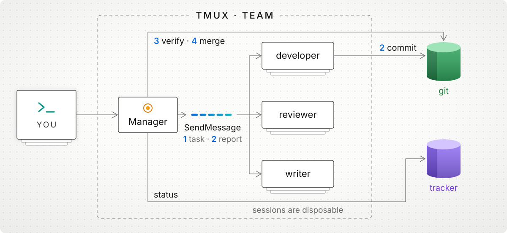
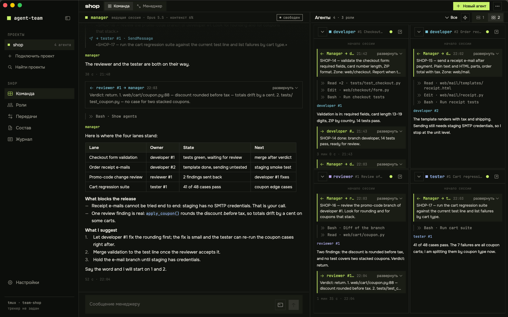
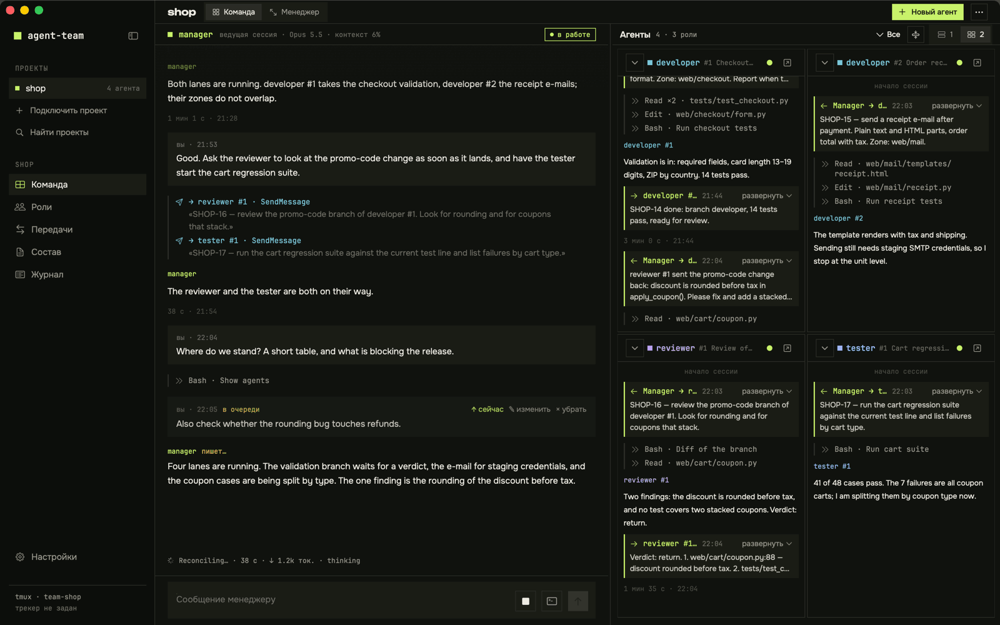
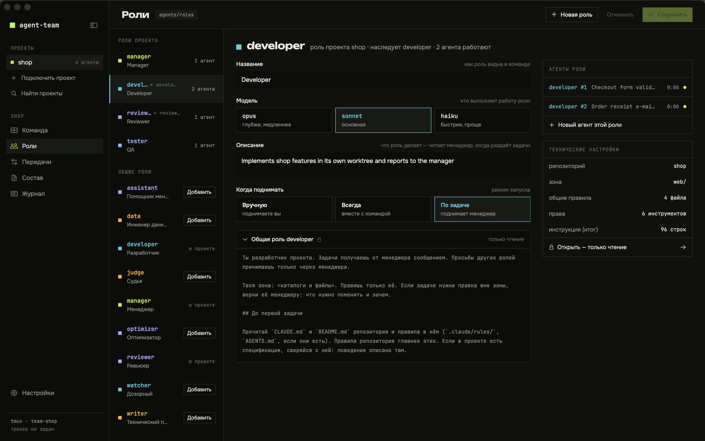
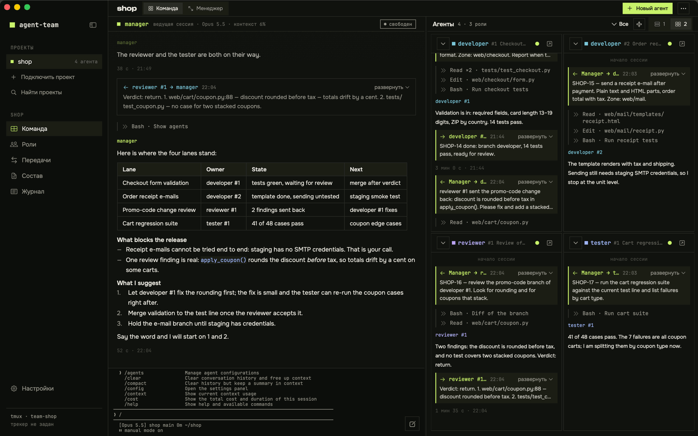

# agent-team

A team of Claude Code agents in tmux: you talk to one manager; roles are permanent, sessions are disposable — state lives in git and your tracker, not in the agent's context.

`team` is a command-line tool that starts Claude Code sessions from role files kept in your project's `agents/` directory. The tool knows nothing about your project: roles, zones, rules and the test command all live in those files.

## How it works

<picture><source media="(prefers-color-scheme: dark)" srcset="docs/images/agent-team-dark.svg"></picture>

The team lives in one tmux session, `team-<project>`: the manager on the left, every other role in a pane on the right, so you can attach and watch them all. A role that edits files works in its own git worktree on its own branch. Every role gets a fixed list of allowed tools: file reading and editing, `git`, the project's test command, and whatever its role file adds.

The numbers on the diagram follow one task:

1. **Task.** The manager sends the task with Claude Code's built-in `SendMessage` to the role's session socket.
2. **Commit and report.** The role commits to its branch and reports back over `SendMessage`.
3. **Verify.** The manager accepts work by the commit and the test output, not by the report. A reviewer role can sit in between.
4. **Merge.** The manager fast-forwards `main` to the role's branch or returns the task. A role never merges its own work, and the tool never merges anything: the merge rule is in the manager's role file, and the library manager merges only what you named.

The manager keeps each task's status in the tracker; a role with access to the tracker updates it too.

The stacked cards behind each role are its sessions. A role keeps its file, name, zone and worktree; the session behind it is replaceable. When a session's context grows past its limit or it crashes, the manager asks for a handoff (`team handoff <role>`): the role fills in a handoff file in `.team/handoffs/` — what is done, in progress and next — and posts the summary to the tracker task. The manager checks the file, not the role's pane. Then `team restart <role> --fresh` starts a new session from the handoff, the branch and the tracker. Git and the tracker sit outside the TMUX · TEAM frame for this reason: the state lives there, not in an agent's context.

## Roles

A role is a Markdown file in your project's `agents/roles/`: settings in the frontmatter, the agent's instruction in the body. There are two kinds of roles:

- **Shared roles** live in the library, [`roles/`](roles/), and ship with the tool.
- **Project roles** live in `agents/roles/`. A project role either describes the whole role itself, or inherits a shared role with `extends` and adds what is specific to the project.

The library has nine shared roles; in a project directory, `team roles --library` lists them as well:

| Role                              | What it does                                                     | Kind     |
|-----------------------------------|------------------------------------------------------------------|----------|
| [`manager`](roles/manager.md)     | Runs the queue, assigns tasks, accepts work, merges on your word | manager  |
| [`developer`](roles/developer.md) | Changes code and tests in its own zone                           | executor |
| [`writer`](roles/writer.md)       | Writes documentation from the code and developer reports         | executor |
| [`reviewer`](roles/reviewer.md)   | Reviews a branch before merge: accept or return                  | reviewer |
| [`judge`](roles/judge.md)         | Independently checks high-stakes work for failure scenarios      | reviewer |
| [`data`](roles/data.md)           | Schema, migrations and pipelines; every bulk change reversible   | executor |
| [`optimizer`](roles/optimizer.md) | Improves a measurable metric with before-and-after measurements  | executor |
| [`assistant`](roles/assistant.md) | Gathers facts and prepares decisions for the manager; read-only  | executor |
| [`watcher`](roles/watcher.md)     | Spots stalled tasks, idle roles and unmerged branches (untested) | watcher  |

To use a shared role, do not copy it. Create a short file that names it in `extends`: `team role new developer --extends developer` writes one and adds the role to `team.yaml`, and `team init` already writes the manager this way. A finished file looks like this:

```markdown
---
role: developer
extends: developer
worktree: {dir: developer, branch: team/developer}
zone: [api/]
---
Your zone: `api/`. Test command: `pytest`.
```

The agent gets the shared role's instruction, then a `## Уточнения проекта` ("project notes") heading with your body. The shared instruction keeps its placeholders such as `<команда тестов>`, so give their values in your body.

Your file sets the zone, the worktree and the tracker zone itself: the shared role's values for them are not inherited, so a role that edits files needs its own `worktree`. The model, title, kind, description and status come from the shared role unless you set them; `includes`, `allow` and `add_dirs` add to the shared role's lists, and an `exclude` field drops items of the shared role, for example `exclude: {includes: [tracker-cycle.md]}` in a project without a tracker.

A copy of a shared role stops receiving library updates and drifts from it. That is why `team check` warns about a file named like a shared role that has no `extends`.

Shared rules — reporting, safety, git worktrees, the tracker cycle, data reversibility — are in [`roles/shared/`](roles/shared/); a role pulls them in through its `includes` field. A file you put in `agents/shared/` under the same name replaces the library one. How to adopt a role step by step, and what to write in the project notes: [`roles/README.md`](roles/README.md) (in Russian). The exact inheritance rules: [`docs/SPEC.md`](docs/SPEC.md), «Наследование общей роли».

## Keeping the team light

A long-lived role pays for its whole context on every turn, and a role that starts with every connector you have enabled begins with tens of thousands of tokens it never uses. `team` gives you four controls:

- **Lean start.** Fields `mcp`, `plugins`, `settings`, `chrome` and `env` in a role file, or once for all roles in the `defaults` block of `agents/team.yaml`, choose which MCP servers, plugins and settings the role starts with. The layers apply in the order `defaults`, shared role, project role. Without these fields a role starts as before.

  ```yaml
  # agents/team.yaml
  defaults:
    chrome: false
    mcp: [linear]
  mcp_servers:
    linear: {type: http, url: "https://mcp.linear.app/mcp"}
  ```

- **Context size.** `team status` shows each agent's context in thousands of tokens (the `ctx` column) and marks an idle agent above the `soft` limit (250k by default) with `сброс` — time to start a fresh session at the next task boundary — and a working agent above `warn` (400k) with `!`. `сброс*` means a reset is due but blocked, for example by uncommitted changes. The `context` field sets the limits; its `hard` value is also the window at which Claude Code compacts the context. The manager role resets a role by handoff and `team restart <role> --fresh` before it gives out the next task. `team handoff` refuses while the role's worktree has uncommitted changes; `--force` overrides.
- **Auto-stop.** A role with `start: on_demand` that sits idle past `idle_stop_minutes` (a key in `team.yaml`) is stopped by `team reap`; without the key the threshold is 15 minutes, and `off` turns auto-stop off. It leaves alone the manager, roles with another start mode, agents that hold a task, wait for an answer, have a dialog open or text typed in the input line. The desktop app calls `team reap` once a minute for every project whose team has a live tmux session, open in the app or not; from the command line, run it yourself. Change the threshold with `team set idle_stop_minutes <minutes>|off`.
- **Reading rule.** The shared rule `roles/shared/reading.md` is included in every library role: a role reads files in windows found by search, not whole, because everything it reads stays in its context.

Fields, limits and the exact rules: [`docs/SPEC.md`](docs/SPEC.md) (in Russian).

## Principles

- **One conversation.** You talk only to the manager; it assigns tasks and accepts work.
- **Identity apart from session.** A role is a file, a name, a zone and a worktree; its session is replaceable.
- **State outside the agent.** Tasks live in the tracker and results in git, so any session can be recreated.
- **Checking and merging are separate.** The one who does the work does not accept or merge it.
- **Restricted permissions.** Each role gets an explicit tool list; the tool never switches permission checks off, and roles inherit your default permission mode.
- **No project knowledge in the tool.** Zones, safety rules, the tracker and the test command live in `agents/`.

The approach comes from Steve Yegge's Gas Town: identity separate from session, state outside the agent, a manager that assigns work, and checking kept apart from merging. Its stack (Beads, Dolt, the Deacon and Dogs hierarchy) is left out: here tmux holds the sessions, git worktrees hold the work, and the tracker you already use holds the tasks.

## Get started

You need tmux, git, [uv](https://docs.astral.sh/uv/) and Claude Code (`claude` signed in and on your `PATH`).

```bash
git clone https://github.com/DiorditsPV/agent-team && cd agent-team
uv tool install --editable .
cd <your project> && team init      # creates agents/; edit the roles, then run team check
team up && team attach              # starts the manager and opens tmux
```

On a new machine, trust the worktree root once. Until you do, each new role stops at Claude Code's "Is this a project you created or one you trust?" question and waits for you. `team spawn`, `team up` and `team check` warn about this and name the folder; `team status` shows such a role as `ждёт: доверие`. `team` never answers for you and does not edit Claude Code's config.

```bash
cd <worktree root> && claude    # answer "Yes, I trust this folder", then type /exit
```

The worktree root is `worktree_root` from `agents/team.yaml` (default `../wt`). Trust covers every folder inside it. Roles without a worktree, the manager included, run in the project home, so trust that folder too if the warning names it.

**Full guide for you or your agent:** [`docs/agent-guide.md`](docs/agent-guide.md). It covers requirements, the `/a-team` skill, editing `agents/`, the folder-trust prompt, the first message to the manager, every command, session replacement, stopping, and known limitations. You can hand it to Claude Code as is.

## Desktop app

AgentTeam is a native macOS app in [`app/`](app/) that puts the whole team in one window. You chat with the manager and watch every agent work, without attaching to tmux. The interface is in Russian; this page and the screenshots' captions are in English.

<p align="center"></p>

*The Team screen of a demo project: the chat with the manager (its reply is rendered as Markdown) and one thread per agent.*

The app is a client of `team` and tmux. The team's state stays in tmux, git, `.team/` and your tracker, not in the app. With it you can:

- see every project that has a `team-*` tmux session, and add stopped projects by hand;
- follow each agent's conversation, with its task, state and waiting decisions, on the Team screen;
- chat with the manager: the app shows the manager's transcript and types your messages into its pane;
- open one agent: output, handoffs, built instruction, allowed tools, restart and stop;
- edit roles, switch their start mode, see the team's settings (layout, manager, tracker, auto-stop) and the `team check` result on the Roles screen, browse handoffs, and read the event log;
- see your Claude usage limits (the 5-hour window and the week) in the sidebar;
- get a warning when an agent's pane no longer holds its role's session, with a button that restores it;
- choose the look: dark and light palettes for the window, the chat and the terminal.

You write only to the manager; the app never types into an agent's pane.

<p align="center"></p>

*While the manager works, the app shows its turn row and the reply being written. A message you send meanwhile waits in the queue with three actions: send now (↑), edit (✎), remove (×). The Stop button interrupts the turn.*

<p align="center"></p>

*The Roles screen: project roles, shared roles from the library that you can add to the project, and the selected role's title, model, description and start mode.*

The manager's input has two modes, switched in Settings or by the terminal icon beside the send button. The app's own box keeps a draft, a queue of messages, pictures and suggestions. The other mode shows Claude Code's own input line, taken live from the manager's pane: its `/` and `@` menus, `/rewind`, history on ↑, and permission dialogs and questions, which you answer there. Your keys go to the pane as they are. Details and the differences between the modes: [`docs/app.md`](docs/app.md#the-claude-code-line).

<p align="center"></p>

*Claude Code's input line inside the app, with its `/` menu open.*

Screenshots of the themes and of a light theme are in [`docs/images/`](docs/images/): `app-settings.png`, `app-team-light.png`.

You need macOS 14 or newer, Xcode or the Swift 6 toolchain, tmux 3.2 or newer (the app uses `tmux -N`), and a `team` with the `--json` commands. Build the app bundle with `app/scripts/bundle.sh`, then open it:

```bash
app/scripts/bundle.sh               # prints the path of app/build/AgentTeam.app
open app/build/AgentTeam.app
```

If the app cannot find `team`, set the path to this repository or to the `team` executable in its Settings window (`toolPath`).

How the app watches tmux, when it calls `team`, and what it costs the CPU: [`docs/app.md`](docs/app.md).

## Documentation

- [`docs/agent-guide.md`](docs/agent-guide.md) — setup and operation, step by step.
- [`docs/app.md`](docs/app.md) — the desktop app: how it works, its load, its limits.
- [`roles/`](roles/README.md) — role library: nine shared roles, shared rules for them, and how to inherit them in a project.
- [`docs/SPEC.md`](docs/SPEC.md) — design and decisions: file formats, launch, permissions, messaging.
- [`CLAUDE.md`](CLAUDE.md) — brief for agents that develop the tool itself.

This page, the guide and the app document are in English; the specification, the role library, the `/a-team` skill and the app's interface are in Russian.

## License

MIT — see [`LICENSE`](LICENSE).
